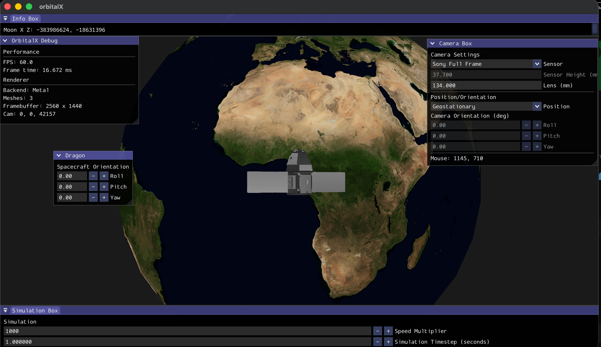
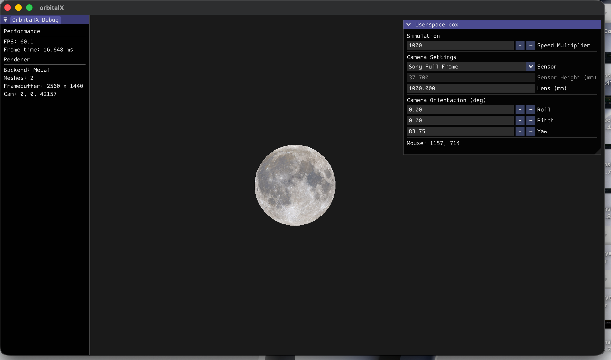
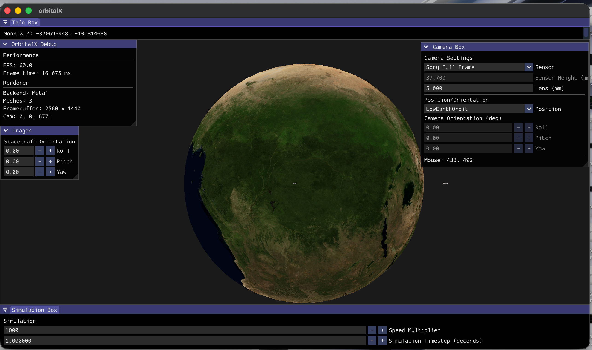
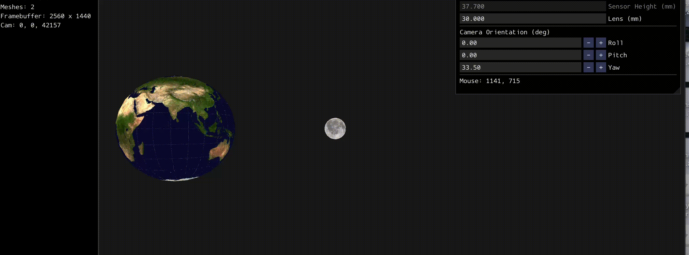

# OrbitalX
A spacecraft orbital analysis and simulation technology demonstrator written in C++ with the bgfx graphics abstraction layer.


Image of a SpaceX Dragon somehow in geostationary orbit captured from a simulated Sony Full-Frame sensor mounted to a 134mm lens. (note: the SpaceX Dragon has never gone to geostationary orbit)


Image of the moon taken with a simulated Sony Full-Frame sensor mounted to a 1000mm lens.


Distortion effect observed from a simulated 5mm lens mounted on a Full-Frame Sony Camera flying above Africa. [That's not a bug btw, thats actually how it looks](https://science.nasa.gov/earth/earth-observatory/fisheye-over-sinai-147993/)


Moon crashing into the earth at 10,000x simulated speed. `dt = 1.0f` Simulated with N-Body newtonian gravitational mechanics using euler integration.

## Building from scratch
Clone this project, recursively:

```sh
git clone git@github.com:InSynchronous/OrbitalX.git --recurse-submodules
```

> [!WARNING]
> If you use a questionable antivirus, it will trigger wrongly about "OrbitalX/submodules/bx/tools/bin/darwin/bin2c", claiming it's `behavioral_detection_30_execution_and_evasion`
> This is completely harmless and isn't even used by the OrbitalX project at all. Check online if you want. **BX is a very popular library, literally used in Minecraft Bedrock Edition itself.**

Build bgfx on linux:
```sh
cd submodules/bgfx
make linux-gcc-release64
```

Build bgfx on MacOS:
```sh
cd submodules/bgfx
make osx-arm64-release
```

This will take an insane amount of time. Be aware.

Build SGP4:
```
cd submodules/sgp4
mkdir build && cd build
cmake ..
cmake --build .
```

Ensure `GLFW` is installed.

Linux:
```sh
./build-linux.sh
```

MacOS:
```sh
./build-osx.sh
```

You should now have an executable in build:
```sh
./build/OrbitalX
```

## Copyright
This project is distrobuted under the MIT licence. See `LICENCE`.
Exceptions to this licencing include the following:

```sh
$ tree assets
assets
├── images
│   ├── earth.jpg  # Image Credit: NASA
│   └── moon.jpg   # Image Credit: NASA
├── models
│   └── Dragon.obj # Model Credit: House-From-Scratch (CGTrader)
```

Thanks to whoever runs this page for the royalty free SpaceX Dragon model. Love from the USA :D.
[House-From-Scratch](https://www.cgtrader.com/designers/house-from-scratch)
